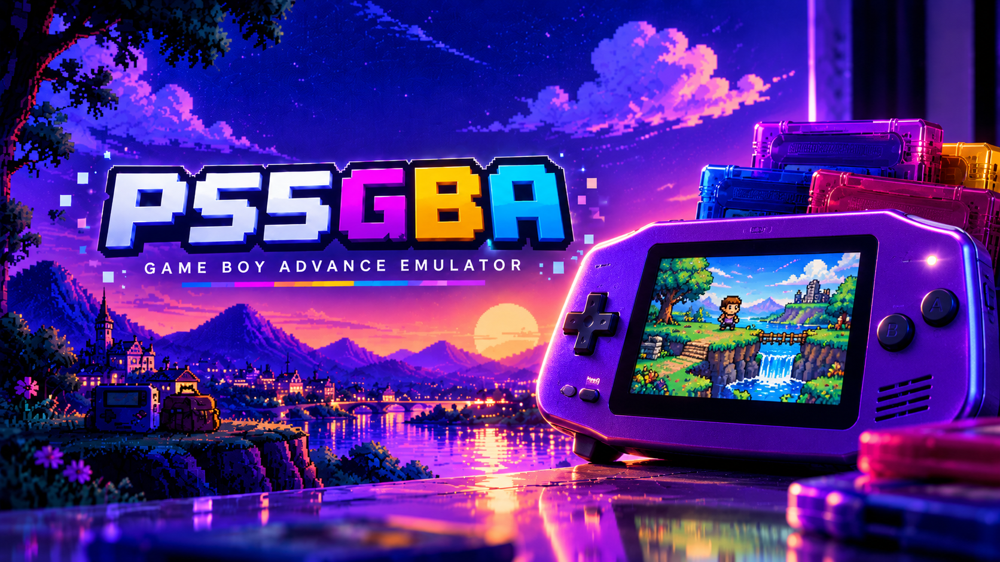

# PS5GBA is a passion project, not a piracy project.

  

**Game Boy Advance games on your PS5, with the original PS5SX2 cover-flow interface.**

**v2.1 — by YAHBALLON** · **App ID: PPSA99209**

PS5GBA is a native PS5 homebrew Game Boy Advance emulator using **mGBA 0.10.5**. It reuses the working PS5SNES frontend while keeping the PS5SX2 shelf, animated game cases, cover glow, reflections, menu sounds and settings panel. The integration and upstream components retain their respective licenses.

**Release status:** the v2.1 ROM discovery fix requires a console retest. This repository contains source; installable application ZIPs must be built and attached separately to a GitHub release. See [RELEASE_NOTES.md](RELEASE_NOTES.md) and [TESTING.md](TESTING.md).

## Features

A native Vulkan interface with the supplied blue Game Boy Advance launcher logo.

- Play **`.gba` ROMs** from internal storage, USB or an **NFSv3 share**.
- Load ZIP archives containing **one GBA ROM**, decompressed directly into RAM.
- Native GBA emulation at **240 × 160**, approximately **59.7275 FPS**.
- Display output up to **3840 × 2160**, with 1080p selection and display-dependent fallback.
- **ORIGINAL**, **4K HD SMOOTH** and **4K ENHANCED** graphics modes.
- Aspect-ratio, stretch and integer scaling, plus adjustable sharpness, contrast and color boost.
- Automatic Libretro GBA box-art downloads, local cover support and **R2 cover refresh**.
- Cached game library, visible loading progress, library reset/rescan and recent-first ordering.
- Battery-backed saves and **one save-state slot per ROM**.
- Configurable GBA buttons and save/load/menu shortcuts, globally or per game.
- Fast forward with muted game audio.
- Controller-operated NFS URL keyboard and a QR web settings page.
- Bounded cover streaming for large libraries, with downloaded covers cached on disk.
- Built-in BIOS fallback; an optional user-provided GBA BIOS is supported.

## Install

1. Download the **application ZIP** from the release assets and extract it.
2. Copy the complete **PPSA99209** folder to:

   ~~~text
   /data/homebrew/PPSA99209/
   ~~~

3. Launch it with your compatible PS5 homebrew launcher.

Keep every packaged file, including `sce_module/libc.prx`, `lapy.elf`, `lapy-manifest.json` and `sce_sys/icon0.png`. Games, saves and settings live separately in `/data/PS5GBA/`.

For an update, replace the application files and restart the app. Preserve the data folder. Refresh the launcher if it still shows the old icon.

The filesystem helper is restricted to this app's title ID. If filesystem access is unavailable, the helper may require the local ELF loader on port **9021**. A normal retail PS5 cannot run this homebrew app.

## Add games

**Supported ROM formats:** `.gba` (case-insensitive) and single-GBA-ROM `.zip` archives. SNES extensions such as `.sfc` and `.smc` are not GBA ROMs. A source-code ZIP downloaded from GitHub is not an installable PS5 build.

If games are not listed, check `/data/PS5GBA/logs/boot.log` for `[library]` scan errors. Restart after adding ROMs or request **Rescan library** in All games settings and restart.

### Internal storage

~~~text
/data/PS5GBA/games/
~~~

These folders are also supported:

~~~text
/data/PS5GBA/roms/
/data/homebrew/PS5GBA/games/
/data/homebrew/PS5GBA/roms/
/data/homebrew/PPSA99209/games/
/data/homebrew/PPSA99209/roms/
/data/GBA/
~~~

### USB

~~~text
/mnt/usb0/homebrew/PS5GBA/games/
~~~

USB0 through USB7 are supported. Alternative folders include:

~~~text
/mnt/usb0/homebrew/PS5GBA/roms/
/mnt/usb0/PS5GBA/games/
/mnt/usb0/PS5GBA/roms/
/mnt/usb0/homebrew/PPSA99209/games/
/mnt/usb0/homebrew/PPSA99209/roms/
/mnt/usb0/GBA/
~~~

Subfolders are scanned up to five levels deep. Games found in these folders are presented in one library.

### NFS

Open **Square → R1 / All games → Settings → Network → NFS URL**.

Example:

~~~text
nfs://192.168.1.10/GBA
~~~

Save the URL and restart PS5GBA. URLs can also be entered in `/data/PS5GBA/nfs.txt`, one share per line.

The app connects directly to the server. ROMs are read into RAM when launched; no PS5 kernel mount is required. Clear saved URLs in All games settings when a share is no longer needed.

### ZIP support

Use **one `.gba` image per ZIP**. Stored and Deflate compression are supported.

- Maximum ROM size: **32 MiB**.
- Maximum ZIP/file size: **64 MiB**.
- Encrypted, multi-ROM and ZIP64 archives are not supported.
- A ZIP containing an entire ROM collection must be unpacked into individual ROMs or individual game ZIPs on your server.

## Graphics settings

Open **Square → Settings → Graphics**. Choose **All games** for global defaults or **This game** for an override.

| Setting | v2 default |
| --- | --- |
| Output resolution | **4K** |
| Graphics mode | **4K ENHANCED** |
| Scaling | **Stretch** |
| Integer scaling | **On** |
| VSync | **Off** |
| Adaptive sharpness | 25% |
| Color boost | 15% |
| Contrast | 105% |
| Display color correction | Off |
| FPS counter | Off |

These five main defaults match a configuration reported to run smoothly on PS5. Existing explicitly saved choices are preserved.

**Stretch takes precedence over integer sizing.** Integer scaling becomes effective when using the original 3:2 aspect ratio.

Resolution and VSync are global startup settings and require an app restart. Other graphics choices apply when the next game starts. VSync-off requires an immediate presentation mode from the Vulkan driver; if unavailable, the app logs the FIFO fallback.

### Graphics modes

| Mode | Presentation |
| --- | --- |
| ORIGINAL | Nearest-neighbor pixels, original colors and no sharpening. |
| 4K HD SMOOTH | Independent edge-aware pixel-art filtering with diagonal interpolation. |
| 4K ENHANCED | Edge-aware filtering with restrained color boost, contrast and adaptive sharpening. |

4K describes the **output framebuffer**. GBA emulation and original artwork remain **240 × 160**; filters do not create newly drawn HD sprites. The edge-aware shader is independently implemented. Experimental high-resolution mGBA OpenGL rendering is not enabled.

## Controls

### Game shelf

| Action | Default |
| --- | --- |
| Browse games | D-pad / left stick, left and right |
| Start game | Cross |
| Open settings | Square |
| Refresh selected cover | R2 |
| This game / All games | L1 / R1 in settings |
| Settings / Controls tab | L2 / R2 in settings |

### In game

| GBA action | Default controller button |
| --- | --- |
| A | Cross |
| B | Circle |
| L | L1 |
| R | R1 |
| Start | Options |
| Select | Create |
| Directions | D-pad; left stick also enabled by default |

| Emulator shortcut | Default |
| --- | --- |
| Save state | L3 + R3 + D-pad Up |
| Load state | L3 + R3 + D-pad Down |
| Return to shelf | Touchpad click |
| Fast forward | Hold L2; game audio is muted |

### Customize your buttons

Open **Square → R2 / Controls** to view and edit assignments.

- Choose **All games** for global defaults or **This game** for an override.
- Left/right or Cross cycles an assignment.
- Fast forward has a configurable held-button assignment.
- Each save/load/menu shortcut has up to three button fields. **None** skips a field; all None disables the shortcut.
- Settings save immediately and apply when the next game is started.
- Save/load shortcuts trigger once per press and consume their bound game inputs.
- Holding **L1 + R1 + touchpad click for two seconds** remains an emergency route back to the shelf.

Saving a new state overwrites that ROM's previous state slot. Battery saves are written periodically and when returning to the menu. Content-derived save names avoid collisions between similarly named games. Incompatible or unreadable existing battery saves are preserved rather than silently replaced.

## Library cache and recent games

The first successful scan creates a local index. Subsequent starts reuse the NFS index while checking local/USB folders for changes. Offline server detection is bounded so local games remain available.

After changing games on an NFS share, choose:

**Square → R1 / All games → Settings → Network → Rescan game library**

Then restart PS5GBA. Library reset and NFS URL removal are also available in All games settings. Changing the share configuration selects a separate cache.

The loading bar indicates activity while the total directory size is unknown, with live game and entry counts.

Under **Library**, choose **Recent games first** to show recently launched games at the front after restarting. The last played game is also remembered for selection. This is library ordering, not a separate recent-games screen.

## Covers

Automatic box art uses the [Libretro GBA Named_Boxarts collection](https://thumbnails.libretro.com/Nintendo%20-%20Game%20Boy%20Advance/Named_Boxarts/).

The app includes a **5,959-filename index**, with exact filename and normalized title/region matching. No-Intro-style ROM/ZIP names work best. Matching handles common accents, such as Pokémon, and ignores bracketed tags during normalized lookup. Images are downloaded on demand; the artwork itself is not bundled.

Press **R2** on the shelf to refresh the selected cover. The previous image is retained if the refresh fails.

For a custom cover:

~~~text
/data/PS5GBA/covers/Game Name (USA).png
~~~

Match the game filename without its extension, or use its displayed GBA serial. PNG and JPEG are supported.

Only nearby artwork is kept live; downloaded covers remain cached on disk. Successful cached covers are reused. The v2 negative-lookup cache is separate from the previous cover source so old failed lookups do not block the new collection.

## BIOS

A proprietary BIOS is **not required** for normal use: mGBA provides a built-in fallback.

If you have your own GBA BIOS, place it at:

~~~text
/data/PS5GBA/bios/gba_bios.bin
~~~

No BIOS is included in the release. BIOS skipping is enabled by default in the current runtime.

## App data and logs

| Content | Location |
| --- | --- |
| Games | `/data/PS5GBA/games/` or `/data/PS5GBA/roms/` |
| Battery saves | `/data/PS5GBA/saves/` |
| Save states | `/data/PS5GBA/states/` |
| Optional BIOS | `/data/PS5GBA/bios/gba_bios.bin` |
| Global settings | `/data/PS5GBA/gs.ini` |
| Per-game settings | `/data/PS5GBA/settings/` |
| Recent games | `/data/PS5GBA/recent-games.txt` |
| Custom covers | `/data/PS5GBA/covers/` |
| Library, cover and shader caches | `/data/PS5GBA/cache/` |
| Boot log | `/data/PS5GBA/logs/boot.log` |
| Cover download errors | `/data/PS5GBA/logs/cover-download.log` |
| NFS URLs | `/data/PS5GBA/nfs.txt` |

If `/data` is unavailable, the app uses `/download0/PS5GBA/` as its fallback data folder. The QR settings page listens on **port 8844** and can provide logs.

Routine mGBA BIOS/DMA DEBUG and INFO traces are suppressed in v2 to avoid continuous disk writes during gameplay. Core warnings and errors remain available.

## Build from source

See [BUILDING.md](BUILDING.md) for the dependency layout and build instructions, and [RELEASING.md](RELEASING.md) for release preparation.

~~~sh
PS5GBA_DEPS=/path/to/prepared/ps5-build bash gba/tools/build.sh
~~~

The active adapter/runtime is in **`gba/src/`**, the upstream core is in **`gba/third_party/mgba/`**, and the native interface uses **`ps5/frontend/`** directly. The GBA build does not compile a SNES or PS2 emulator core. The required PS5 SDK/Vulkan/network dependencies are prepared externally, as in the PS5SNES build.

Run the host regression suite with:

~~~sh
python3 gba/tools/test.py
~~~

## Current limits and testing

- One active player in the current integration.
- One save-state slot per ROM; states are tied to the core/version. Keep battery saves for portability.
- Tilt, gyro, solar-sensor controls and multiplayer are not exposed.
- No separate in-game pause overlay or folder-tree browser; touchpad returns to the shelf and subfolders are scanned recursively.
- General firmware compatibility and sustained PS5 GPU performance across games have not been established.
- A user tested GBA games on PS5 and reported smooth gameplay after selecting the configuration now used as the v2 defaults. The new v2 build still needs a console retest.
- Historical host test reports describe real ARM execution, 240 × 160 video, audio, GBA timing, controller input, SRAM/state persistence, ZIP loading, settings, audio resampling and actual Vulkan rendering through 4K.
- Pokémon Emerald and the German Smaragd-Edition cover matches were checked against live, valid PNG downloads.
- See [TESTING.md](TESTING.md) for the remaining console checklist, including Flash/EEPROM and RTC cartridges.
- No commercial ROMs, proprietary BIOS files or console keys are included.

## Credits and license

- **YAHBALLON** — project customization and supplied logo.
- **Spyros and PCSX2 contributors** — original PS5SX2 interface and shared frontend.
- [mGBA contributors](https://github.com/mgba-emu/mgba) — Game Boy Advance emulation; **MPL-2.0**.
- [mihawk-99 / PS5_Vulkan](https://github.com/mihawk-99/PS5_Vulkan) — native Vulkan driver and runtime work.
- [BlackBearReloaded / ps5-native-app-boilerplate](https://github.com/blackbearreloaded/ps5-native-app-boilerplate) — native startup and packaging tooling.
- [Lapy filesystem helper](https://github.com/mpereiraesaa/PS5-Lapy-JB-Daemon) — restricted filesystem helper.
- [Libretro thumbnails](https://thumbnails.libretro.com/) — box-art collection.
- Libnfs, libcurl, OpenSSL, zlib, zstd, libpsl and the bundled font/library authors.

SkyEmu was a presentation reference; no SkyEmu code was incorporated. The edge/color shader is independently implemented.

PS5GBA integration code is **GPL-3.0-or-later**. Upstream components retain their own licenses and notices. See [COPYING.GPLv3](COPYING.GPLv3), [THIRD_PARTY_NOTICES.md](THIRD_PARTY_NOTICES.md) and the included license files.

## v2 by YAHBALLON (AI-assisted)

Adds automatic Libretro GBA covers with normalized title/region matching, local caching and R2 refresh. Changes the default graphics configuration to **4K / 4K ENHANCED / Stretch / Integer Scaling on / VSync off**, based on the user's successful console configuration. Suppresses repeated core BIOS/DMA traces while retaining warnings and errors. Existing explicit settings and saves are retained. Earlier native builds, cover checks and host core tests were reported as passing; these have not been rerun for this checkout, and the updated release still needs console testing.
